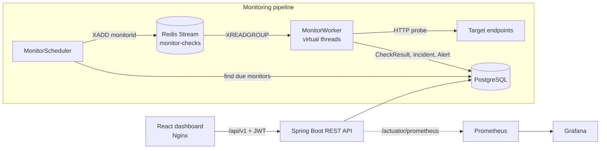

# PulseOps — API Health Monitoring Platform

PulseOps periodically checks HTTP endpoints, records status codes and latency, opens an incident when a check fails, resolves it when the endpoint recovers, and shows all of it on a React dashboard.

The interesting part is the check pipeline: a scheduler pushes due monitors onto a **Redis Stream**, and a worker consumes them and runs each HTTP check on a **Java 21 virtual thread**. The results then drive the incident lifecycle.

> **Origin and contributions.** This project is built on [PulseOps by @vinay23is](https://github.com/vinay23is/pulseops-api-monitoring-paas). I'm extending it: auditing the code against its documented behaviour, fixing the correctness bugs I find, adding tests, and building new features. My changes are listed under [My contributions](#my-contributions).

---

## Features

| Area                  | What it does                                                                                                               |
| --------------------- | -------------------------------------------------------------------------------------------------------------------------- |
| **Auth**              | Register/login, stateless JWT, BCrypt password hashing                                                                     |
| **Multi-tenancy**     | Users own projects, projects own monitors; every query is scoped to the authenticated user                                 |
| **Projects**          | Group monitors per project; each project has a public status page by slug                                                  |
| **Monitors**          | HTTP monitors with method, expected status code, interval, timeout; pause/resume                                           |
| **Check pipeline**    | Scheduler → Redis Stream (consumer group) → worker on virtual threads → non-blocking WebClient probe                       |
| **Results**           | Every check stores status code, latency, success flag and error message                                                    |
| **Incidents**         | Opened on failure, failure count incremented on repeated failures, auto-resolved on recovery                               |
| **Alerts**            | Recorded on DOWN and RECOVERED transitions (in-app; email is simulated; see [known issues](#known-issues-and-roadmap))     |
| **API keys & events** | Per-project API keys (BCrypt-hashed, prefix lookup, revocable) for a rate-limited `POST /api/v1/events` ingestion endpoint |
| **Dashboard**         | Monitor status (UP / DOWN / PAUSED), uptime, average latency, open incidents, recent checks                                |
| **Observability**     | Actuator health probes, Micrometer metrics, Prometheus scrape, provisioned Grafana dashboard                               |
| **API docs**          | OpenAPI / Swagger UI                                                                                                       |
| **CI**                | GitHub Actions: backend tests, frontend build, Docker image builds, Helm lint/render, Terraform fmt/validate               |

## Architecture



All components run in a single Spring Boot service. The scheduler and worker can each be switched off with `pulseops.monitor.scheduler-enabled` and `pulseops.monitor.worker-enabled`, so they could be split into separate deployments.

## How a check works

1. **Schedule.** `MonitorScheduler` runs periodically, selects active monitors that are due, and appends `{monitorId}` to the `monitor-checks` Redis Stream.
2. **Consume.** `MonitorWorker` reads from the stream as part of a consumer group, and each message becomes a task on a virtual-thread executor.
3. **Probe.** The worker sends the HTTP request with the monitor's method and timeout, then measures the status code and latency.
4. **Evaluate.** If the actual status equals `expectedStatusCode`, the check succeeds; otherwise it fails.
5. **Persist.** A `CheckResult` row is written and `lastCheckedAt` is updated.
6. **Incident and alert.** The worker opens or resolves an incident (below) and records an alert on each state change.

A monitor's dashboard status is derived from its state, not stored on the monitor:

| `active` | open incident? | Shown as   |
| -------- | -------------- | ---------- |
| false    | —              | **PAUSED** |
| true     | yes            | **DOWN**   |
| true     | no             | **UP**     |

## Design decisions

**Redis Streams between scheduler and worker.**
Deciding _what is due_ is decoupled from _executing the check_. The scheduler only appends monitor IDs; workers in a consumer group pull them. So check execution can scale out to more consumers without the scheduler knowing how many exist, and a burst of due monitors queues up instead of blocking the scheduler. Streams were chosen over Pub/Sub because they persist messages and track per-consumer pending entries. (Limitation: the worker currently ACKs on receipt, before the check completes; see the roadmap.)

**Virtual threads for checks.**
A health check is almost entirely network wait. A Java 21 virtual-thread-per-task executor gives each check simple blocking code (`WebClient … .block()` with a timeout) without tying up a platform thread per in-flight request. Many slow or timing-out endpoints therefore don't starve the others.

**Monitor status is derived, not stored.**
UP / DOWN / PAUSED is computed from `active` plus "is there an OPEN incident", and exposed only in the response DTO. Storing a status column would duplicate state that can drift from the incident table.

**Read models for aggregate data.**
Monitor counts per project come from a JPQL interface projection (`COUNT` + `GROUP BY`), not from loading `project.getMonitors()`. Relationships stay `LAZY`; read endpoints use projections and write paths use entities.

**API keys: hashed, with a plaintext prefix for lookup.**
The full key is shown once and stored only as a BCrypt hash. The first 10 characters are stored in clear and indexed, so a request finds its candidate row by prefix and runs a single BCrypt comparison, instead of comparing against every stored hash.

**Fixed-window rate limiting in Redis.**
Each API-key prefix gets a counter per minute (`INCR rate:{prefix}:{minute}`, 90s TTL). It's simple, O(1), and shared across app instances. The trade-off is that bursts at a window boundary can briefly allow up to 2× the limit; a sliding-window log or token bucket would be stricter.

**Two deployment paths.**
Docker Compose is the quick local stack. The repository also includes a Helm chart and a Terraform skeleton for Kubernetes, which CI lints and renders.

## Tech stack

- **Backend:** Java 21, Spring Boot 3.2 (Web, Data JPA, Security, Validation, WebFlux/WebClient, Actuator), jjwt, SpringDoc OpenAPI, Maven
- **Data:** PostgreSQL 16, Redis 7 (Streams)
- **Frontend:** React 18, Vite, React Router, Axios, Tailwind CSS, Recharts
- **Ops:** Docker, Docker Compose, Nginx, Prometheus, Grafana, GitHub Actions CI; a Helm chart and Terraform skeleton are included from the original project

## Running locally

**Prerequisites:** Docker and Docker Compose.

```bash
git clone <this-repo-url>
cd <repo>
docker compose up --build
```

| Service     | URL                                   |
| ----------- | ------------------------------------- |
| Frontend    | http://localhost:5173                 |
| Backend API | http://localhost:8080/api/v1          |
| Swagger UI  | http://localhost:8080/swagger-ui.html |
| Prometheus  | http://localhost:9090                 |
| Grafana     | http://localhost:3000 (admin / admin) |

Demo user (seeded on startup):

```
Email:    demo@pulseops.dev
Password: demo123
```

The frontend container serves the built React app with Nginx and proxies `/api/` to the backend. The backend reads its Redis connection from `REDIS_URL` (set in `docker-compose.yml`).

## API

All endpoints are under `/api/v1` and need `Authorization: Bearer <jwt>` unless marked public. Full schema: Swagger UI.

| Method              | Path                                                | Notes                                       |
| ------------------- | --------------------------------------------------- | ------------------------------------------- |
| POST                | `/auth/register`, `/auth/login`                     | public; returns JWT                         |
| GET                 | `/dashboard`                                        | aggregated status for the current user      |
| POST / GET          | `/projects`                                         | create / list (with monitor count)          |
| GET / DELETE        | `/projects/{id}`                                    |                                             |
| POST / GET          | `/projects/{projectId}/monitors`                    |                                             |
| GET / PUT / DELETE  | `/projects/{projectId}/monitors/{monitorId}`        |                                             |
| PATCH               | `/projects/{projectId}/monitors/{monitorId}/toggle` | pause / resume                              |
| GET                 | `/incidents`, `/projects/{projectId}/incidents`     |                                             |
| GET                 | `/alerts`, `/projects/{projectId}/alerts`           |                                             |
| POST / GET / DELETE | `/projects/{projectId}/api-keys[/{keyId}]`          |                                             |
| POST                | `/events`                                           | public, API-key authenticated, rate limited |
| GET                 | `/status/{slug}`                                    | public status page data                     |

Example:

```bash
TOKEN=$(curl -s -X POST localhost:8080/api/v1/auth/login \
  -H 'Content-Type: application/json' \
  -d '{"email":"demo@pulseops.dev","password":"demo123"}' | jq -r .token)

curl -s -X POST localhost:8080/api/v1/projects/1/monitors \
  -H "Authorization: Bearer $TOKEN" -H 'Content-Type: application/json' \
  -d '{"name":"httpbin 200","url":"https://httpbin.org/status/200","expectedStatusCode":200,"intervalSeconds":60,"timeoutSeconds":10}'
```

## Observability

- `GET /actuator/health` (liveness and readiness probes enabled)
- `GET /actuator/prometheus`: includes custom metrics for check outcomes, check latency, dispatch batch size and enqueue failures
- Grafana auto-provisions a Prometheus datasource and a PulseOps overview dashboard

## My contributions

Fixes so far, each found by reading the code and reproducing the behaviour:

- **Local Docker setup.** The backend container never received `REDIS_URL`, so Spring Data Redis failed at startup (`The URL '' is not valid`). Fixed in `docker-compose.yml`.
- **Frontend API target.** `.env.production` pointed at a remote hosted backend. It now uses the same-origin `/api/v1`, proxied by Nginx to the local backend.
- **`LazyInitializationException` on project endpoints.** Response mapping called `project.getMonitors().size()` after the Hibernate session had closed. Instead of switching the relationship to `EAGER`, I added a `ProjectSummary` interface projection that computes `COUNT(m)` in the query (`LEFT JOIN … GROUP BY`). Read endpoints use the projection; write paths still use the entity.
- **Monitor status was never DOWN.** The UI badge supported a DOWN state, but the API never exposed incident state. I added `hasOpenIncident` to `MonitorResponse` as derived read-model state (not a column on `Monitor`), computed via the existing `IncidentService` rule, and wired it through the dashboard and monitor list.
  In progress: see the next section.

## Known issues and roadmap

Found during code review and being fixed now:

- [ ] **Expected 4xx/5xx statuses are always reported as failures.** The worker uses `WebClient.retrieve()`, which turns 4xx/5xx responses into exceptions before the expected-status comparison runs. So a monitor that expects `500` and gets `500` is marked DOWN.
- [ ] **`intervalSeconds` is not enforced.** The scheduler uses a fixed cutoff, so every monitor is checked about every 30s whatever its configured interval.
- [ ] **Client-wide 10s HTTP timeout.** This silently caps per-monitor `timeoutSeconds` values above 10.
- [ ] **Expired or invalid JWTs return 403 instead of 401.** No authentication entry point is configured, so the frontend can't tell "log in again" apart from "not allowed".
- [ ] **The dashboard doesn't auto-refresh.** Status and "last checked" go stale until you reload.
- [ ] **Some dashboard aggregates are wrong.** Recent checks only cover the first project, and uptime shows the worst project rather than overall uptime.
      Later:

- [ ] TLS certificate expiry monitoring (expiry date, days remaining, issuer; warning threshold leads to an incident)
- [ ] Worker reliability: acknowledge stream messages only after the check is persisted, and handle retries and pending messages
- [ ] SSRF protection for user-supplied monitor URLs (block loopback, private, link-local and metadata ranges; validate redirects)
- [ ] Real email and webhook alert delivery (email is currently simulated; webhook URLs aren't configurable yet)
- [ ] Horizontal scaling: one active scheduler (Redis lock) and a consumer name per pod
- [ ] Broader automated test coverage
